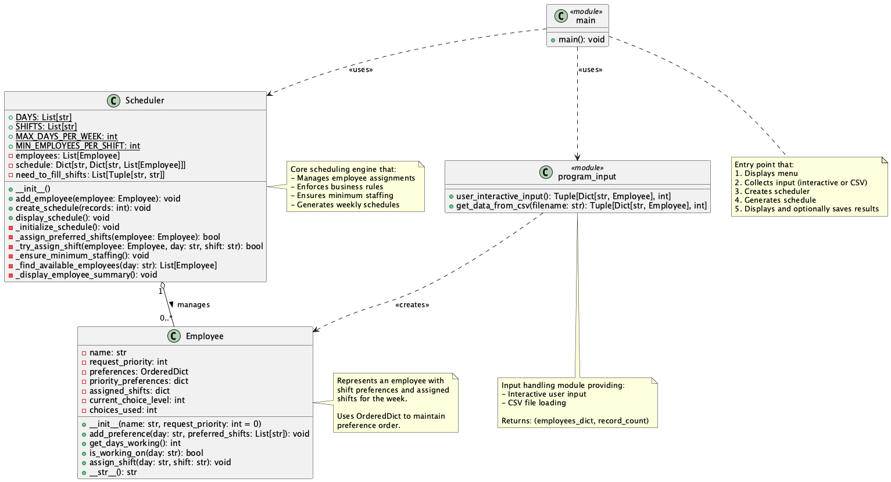

## Requirements

### Python Version
- Python 3.7 or higher

### Dependencies
- No external dependencies required (uses only standard library)

### System Requirements
- Any operating system (Windows, macOS, Linux)
- Terminal/Command Prompt access

## Installation

### Step 1: Clone the Repository
```bash
git clone https://github.com/SammySheu/ShifScheduling.git
cd Python
```

### Step 2: Verify Python Installation
```bash
python3 --version
```

Expected output: `Python 3.7.x` or higher

## Running the Application
```bash
python3 main.py
```

### Two mode : Interactive vs Test 
When prompted, select option **1** for interactive mode.
When prompted, select option **2** for test mode.

#### Interactive Mode Instructions:
1. Enter employee names one at a time
2. For each employee, specify shift preferences for day of the week
3. Available days: Monday, Tuesday, Wednesday, Thursday, Friday, Saturday, Sunday
4. Available shifts: Morning, Afternoon, Evening
5. Press Enter to skip entering the preference
6. Type 'done' when finished entering all employees

## Application Flow

### Phase 0: User Input
- User could choose either csv input or interactive input

### Phase 1: Scheduling preference
- Employee's preference would be dealed first. 
- To be fair, select one preference from one employee one at a time.
- For example, EmployeeA submit 5 preferences and EmployeeB submit 2 preferences. Program will deal with following order A -> B -> A -> B -> A -> A -> A
- If preference is not availabe, program will deal with the next preference under the same employee
- **Conflict Resolution** is implemented in this phase. That means program won't assign a shift more than 2 employees.

### Phase 2: Scheduling
- After scheduling everyone's preference, program start to check whether each shift achieve minimum requirement.
- **Minimum Staffing** is implementing here to ensure each shift has at least 2 employees

### Phase 3: Output
- Displays complete weekly schedule
- Shows employee summary with individual schedules
- Option to save schedule to file

## Output Format

### Schedule Display
The output shows:
- Day-by-day breakdown
- Shift assignments with employee names
- Staff count per shift
- Status indicators (✓ for adequate staffing, ⚠ for warnings)

### Employee Summary
For each employee:
- Total days working
- Individual schedule breakdown
- Day and shift assignments

## Sample Output

```
================================================================================
                         WEEKLY EMPLOYEE SCHEDULE
================================================================================

────────────────────────────────────────────────────────────────────────────────
  MONDAY
────────────────────────────────────────────────────────────────────────────────
  ✓ Morning       (2 staff): Alice Johnson, Carol Williams
  ✓ Afternoon     (2 staff): Bob Smith, Grace Wilson
  ✓ Evening       (2 staff): Emma Davis, Frank Miller

...

                         EMPLOYEE SUMMARY
================================================================================

  Alice Johnson:
    Total days working: 3/5
    Schedule:
      - Monday: Morning
      - Wednesday: Morning
      - Friday: Afternoon

  Bob Smith:
    Total days working: 4/5
    Schedule:
      - Monday: Afternoon
      - Tuesday: Morning
      - Thursday: Evening
      - Saturday: Morning
...
```

## File Structure

```
Python/
├── main.py                 # Main Python application
├── program_input.py        # function stored for two input methods
├── employee.py             # Employee class and its method
├── scheduler.py            # Scheduler class and its method
├── README.md               # This file
└── test_data.csv           # Users could copy this file as their input or served as test data. 
```

## Code Structure

### UML

1. **Employee**: Represents an employee with preferences and assignments
2. **Scheduler**: Manages the scheduling system


## Constraints and Rules

### Hard Constraints (Always Enforced)
1. No employee works more than 1 shift per day
2. Maximum 5 working days per week per employee
3. Minimum 2 employees per shift per day (unless no employee left)