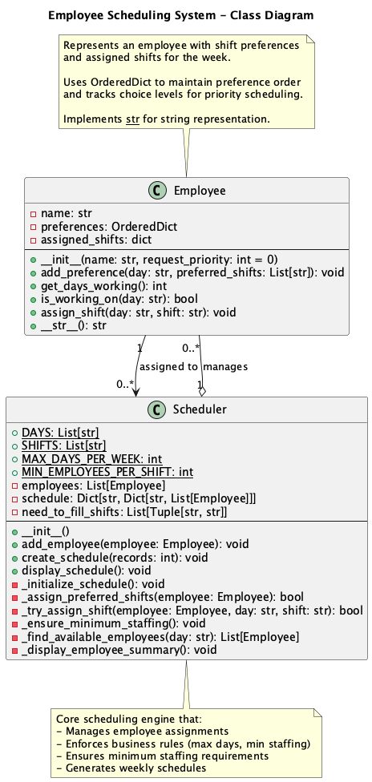

# Shift Scheduling System

## Overview
This application manages employee schedules for a company operating 7 days a week with three shifts (Morning, Afternoon, Evening). It implements various control structures including conditionals, loops, and branching logic to assign shifts while respecting constraints and employee preferences.

## Features

### Core Features
1. **Input and Storage**: Collects employee names and shift preferences for each day
2. **Scheduling Logic**: 
   - Ensures no employee works more than one shift per day
   - Limits employees to maximum 5 days per week
   - Guarantees minimum 2 employees per shift per day
3. **Conflict Detection and Resolution**: Automatically handles scheduling conflicts
4. **Readable Output**: Displays complete weekly schedule and employee summaries
5. **Priority Preferences (Bonus)**: Supports priority ranking for shift preferences

### Control Structures Demonstrated
- **Conditionals**: if/else statements for validation and decision making
- **Loops**: for loops, while loops for iteration and scheduling
- **Branching**: Complex logic for conflict resolution
- **Data Structures**: 
  - Classes, dictionaries, lists for Python
  - Structs, HashMap, Vec for Rust

## Class Diagram(UML)

